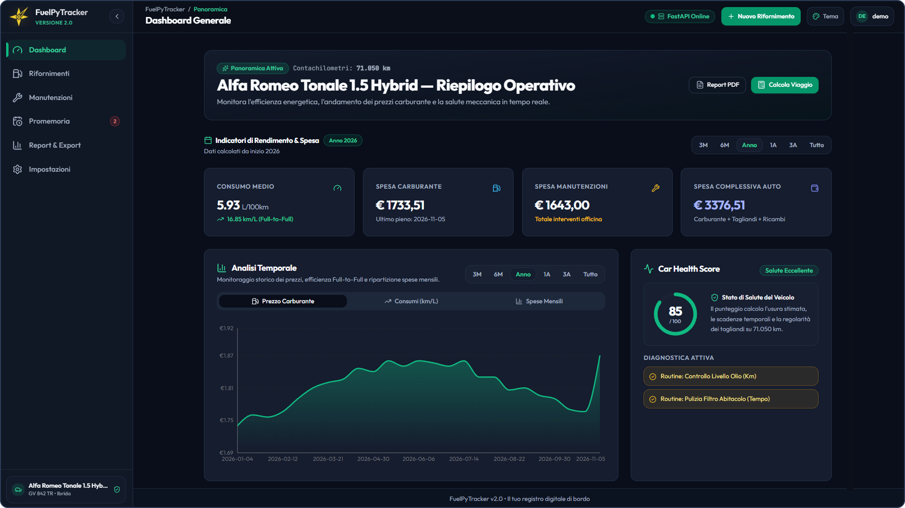

<div align="center">


# ⛽ FuelPyTracker V2.0

### Piattaforma intelligente, predittiva e data-driven per la gestione completa del veicolo

[](https://www.python.org/)
[](https://fastapi.tiangolo.com/)
[](https://react.dev/)
[](https://www.typescriptlang.org/)
[](https://tailwindcss.com/)
[](https://www.docker.com/)
[](LICENSE)

</div>

<div align="justify">

---

## 🌟 Panoramica del Prodotto

**FuelPyTracker V2** è un'applicazione web moderna e disaccoppiata per il monitoraggio analitico del veicolo.  
Nata dall'evoluzione dell'originale prototipo in Streamlit, la versione 2.0 unisce un'interfaccia **React 19** veloce e reattiva a un **Backend in FastAPI**, garantendo una consultazione comoda sia dalla scrivania di casa sia dallo smartphone direttamente al distributore di carburante.

<div align="center">
  
</div>

---

## ✨ Funzionalità Distintive

- 📊 **Dashboard Analitica e Decisionale:** Monitoraggio in tempo reale dei consumi effettivi (*km/L*), costo chilometrico (*€/km*) e andamento delle spese con filtri temporali (3M, 6M, 1A, Tutto) e calcolatore dei costi di viaggio integrato.
- ⛽ **Gestione Rifornimenti con Smart OCR:** Registrazione immediata dei pieni con calcolo automatico *Full-to-Full*. Scansione degli scontrini tramite **OpenAI GPT-4o Vision** per pre-compilare data, importo, prezzo al litro, litri e stazione di servizio a partire da una foto.
- 🔧 **Manutenzioni e Scadenziario Ibrido:** Registro interventi ordinari e straordinari per categoria (tagliando, freni, gomme, revisione) con soglie di avviso sia per data che per chilometraggio.
- ⏰ **Promemoria Periodici:** Monitoraggio dei controlli ricorrenti di routine (olio, pressione pneumatici, liquidi) con avanzamento calcolato in base ai chilometri percorsi.
- 📑 **Hub Report e Libretto Digitale PDF:** Importazione guidata da file CSV/Excel in due fasi con anteprima e correzione errori prima del salvataggio. Generazione con un clic del Libretto di Manutenzione in formato PDF stampabile.
- 🎨 **Tre Temi Grafici ed Ergonomia Mobile:** Tre ambientazioni visive integrate (**Dark Slate**, **OLED Pure Black** per schermi AMOLED e **Clean Light**) con caricamento immediato all'avvio e barra di navigazione inferiore pensata per l'uso con una mano su smartphone.
- 🔒 **Isolamento e Doppia Modalità Database:** Compatibile nativamente sia con **SQLite** (locale, zero configurazione) sia con **PostgreSQL / Supabase** con isolamento dei dati per singolo utente (*Row Level Security*).

---

## 🛠️ Stack Tecnologico

| Livello | Tecnologie | Caratteristiche Chiave |
| :--- | :--- | :--- |
| **Frontend** | React 19, TypeScript, Vite, Tailwind CSS, Lucide | Interfaccia web reattiva, tre temi grafici integrati e layout adattivo desktop/smartphone. |
| **Dati & Cache Client** | TanStack Query v5 | Sincronizzazione automatica delle viste a ogni modifica senza necessità di ricaricare la pagina. |
| **Backend API** | FastAPI (Python 3.12+), Pydantic v2, Uvicorn | API RESTful, validazione preventiva dei dati e documentazione Swagger generata automaticamente. |
| **Persistenza** | SQLAlchemy ORM, SQLite / PostgreSQL (Supabase) | Supporto dual-database per uso locale autonomo o cloud multi-utente con RLS. |
| **AI & Documenti** | OpenAI GPT-4o Vision, FPDF, OpenPyXL | Lettura automatica degli scontrini carburante, generazione Libretto PDF ed export/import Excel. |
| **Distribuzione** | Docker, Docker Compose | Avvio completo di frontend, backend e database locale con un solo comando. |

---

## ⚡ Avvio Rapido (Quick Start)

### Opzione A: Avvio con Docker Compose (Consigliato)

Il modo più rapido per avviare l'intero progetto in locale:

```bash
# 1. Clona il repository
git clone https://github.com/Lorenzo-001/FuelPyTracker.git
cd FuelPyTracker

# 2. Configura il file d'ambiente del backend
cp backend/.env.example backend/.env

# 3. Avvia i container
docker compose up --build -d
```

- **Applicazione Web:** `http://localhost:80` (o `http://localhost:3000`)
- **Swagger API Docs:** `http://localhost:8000/docs`
- **Health Check:** `http://localhost:8000/health`

Per arrestare: `docker compose down`.

---

### Opzione B: Sviluppo Locale (Senza Docker)

```bash
# Terminale 1: Backend FastAPI
python -m venv venv
# Windows: .\venv\Scripts\Activate.ps1 | Linux/macOS: source venv/bin/activate
pip install -r backend/requirements.txt
cp backend/.env.example backend/.env
uvicorn backend.src.api.server:app --reload --port 8000

# Terminale 2: Frontend React
cd frontend
npm install
npm run dev
```
L'applicazione in modalità sviluppo sarà disponibile su `http://localhost:5173`.

---

## 📚 Struttura della Documentazione

La documentazione del progetto è raccolta nella cartella [`docs/`](docs/) ed è suddivisa per argomento:

```text
docs/
├── functional/               # Guide funzionali ed esperienza utente
│   ├── USER_GUIDE.md         # Guida completa alle sezioni dell'app e al loro utilizzo
│   └── THEMES_AND_UI.md      # I tre temi grafici e l'adattamento tra computer e smartphone
├── architecture/             # Architettura del sistema e scelte progettuali
│   ├── OVERVIEW.md           # Vista d'insieme, gestione database, servizi cloud e privacy
│   ├── BACKEND.md            # Struttura FastAPI, moduli API e servizi di calcolo
│   └── FRONTEND.md           # Interfaccia React, sincronizzazione dati e layout adattivo
├── technical/                # Guide tecniche e di integrazione
│   ├── SETUP_GUIDE.md        # Guida di installazione Docker, locale e variabili .env
│   ├── API_REFERENCE.md      # Riferimento API REST, codici HTTP e domini operativi
│   └── DATABASE_SCHEMA.md    # Tabelle del database, indici e Row Level Security
└── archive/                  # Documentazione storica e note di migrazione
    ├── v1-legacy/            # Documenti originali della versione Streamlit v1
    └── migration-notes/      # Storia tecnica della migrazione a V2, razionale e limiti noti
```

---

## 📄 Licenza

Distribuito sotto licenza **MIT**. Consulta il file [LICENSE](LICENSE) per ulteriori dettagli.

</div>
