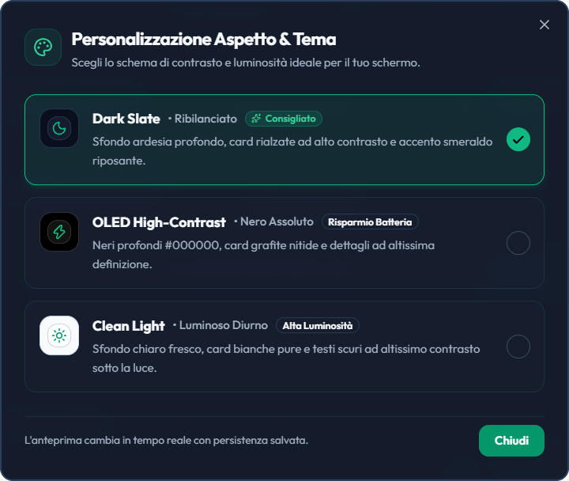
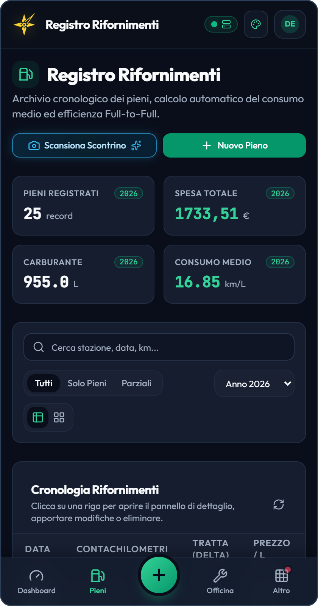

# 🎨 Temi ed Esperienza d'Uso — V2.0

> **Un'interfaccia moderna, chiara e comoda da usare in qualsiasi situazione: dalla scrivania di casa alla sosta al distributore.**

---

## 🌟 Principi di Design

L'interfaccia di FuelPyTracker V2 è stata progettata mettendo al centro la praticità d'uso quotidiana:
1. **Chiarezza Immediata:** I dati più importanti (chilometraggio, costi, consumi) sono subito visibili senza distrazioni, con testi ben leggibili e una disposizione ordinata.
2. **Comodità in Movimento:** Pulsanti e comandi sono dimensionati per essere usati facilmente con una sola mano sullo smartphone, anche mentre ci si trova al distributore.
3. **Cura Visiva:** Colori equilibrati, transizioni discrete e contrasti studiati per non affaticare la vista né di giorno né di sera.

---

## 🌓 I Tre Temi Grafici

FuelPyTracker mette a disposizione tre temi visivi pensati per diverse condizioni di luce e tipologie di schermo:

  
   
  <em>Figura 1: Finestra di selezione del tema con anteprima immediata.</em>

| Tema | Stile Visivo | Quando Consigliarlo |
| :--- | :--- | :--- |
| **Dark Slate** *(Predefinito)* | Toni grigio-ardesia scuri, contrasti morbidi e dettagli verde smeraldo | Uso quotidiano su computer e in ambienti chiusi. Riposa la vista durante la consultazione prolungata. |
| **OLED Pure Black** | Sfondo nero assoluto e contrasto netto | Smartphone con schermi OLED o AMOLED. Riduce il consumo della batteria e offre un'ottima leggibilità di sera o di notte. |
| **Clean Light** | Sfondo chiaro luminoso e bordi ben definiti | Utilizzo all'aperto sotto la luce diretta del sole o per chi preferisce le classiche interfacce su sfondo bianco. |

### Memorizzazione Automatica del Tema
La scelta del tema viene salvata automaticamente sul dispositivo in uso.  
Quando apri o ricarichi l'applicazione, il tema selezionato viene applicato all'istante prima ancora che compaia la pagina: in questo modo chi utilizza un tema scuro evita il fastidioso effetto di "schermata bianca" iniziale.

---

## 📱 Utilizzo su Computer e Smartphone

L'applicazione adatta automaticamente la disposizione degli elementi in base allo schermo utilizzato:

  
   
  <em>Figura 2: Interfaccia su smartphone con barra di navigazione inferiore a portata di pollice.</em>

### Computer e Tablet (Schermi ampi)
- **Barra di Navigazione Superiore:** Menu orizzontale completo con accesso diretto a tutte le sezioni e pulsante rapido per registrare un nuovo rifornimento.
- **Tabelle e Riepiloghi Affiancati:** Visualizzazione ampia con filtri di ricerca, ordinamento delle colonne e pulsanti di esportazione sempre a portata di clic.
- **Finestre di Inserimento Guidate:** Moduli di compilazione spaziosi con controlli automatici che segnalano subito eventuali sviste.

### Smartphone (Uso in mobilità)
- **Barra di Navigazione Inferiore:** Menu fisso nella parte bassa dello schermo, comodo da raggiungere con il pollice per passare rapidamente tra Dashboard, Rifornimenti, Manutenzioni, Promemoria e Report.
- **Vista a Schede Compatte:** Le tabelle si trasformano automaticamente in schede verticali ordinate, facili da leggere senza mai dover scorrere lo schermo in orizzontale.
- **Fotocamera Integrata per gli Scontrini:** Possibilità di scattare direttamente una foto alla ricevuta del distributore per compilare automaticamente i dati di spesa e carburante.

