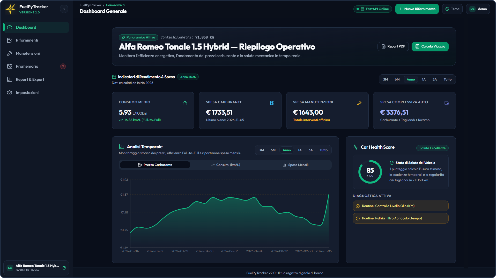
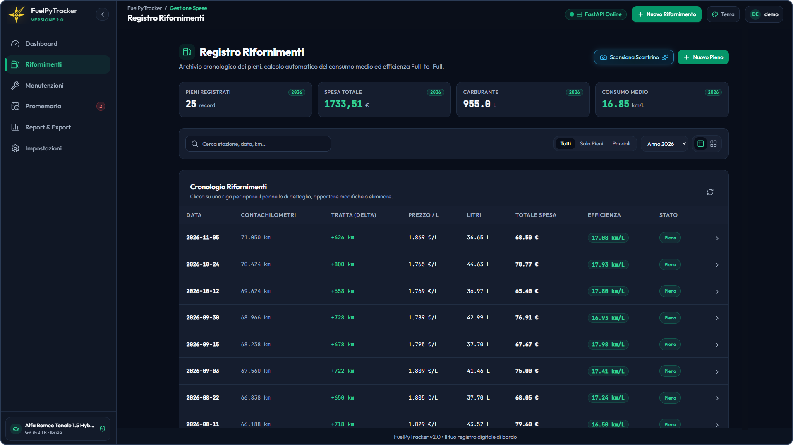
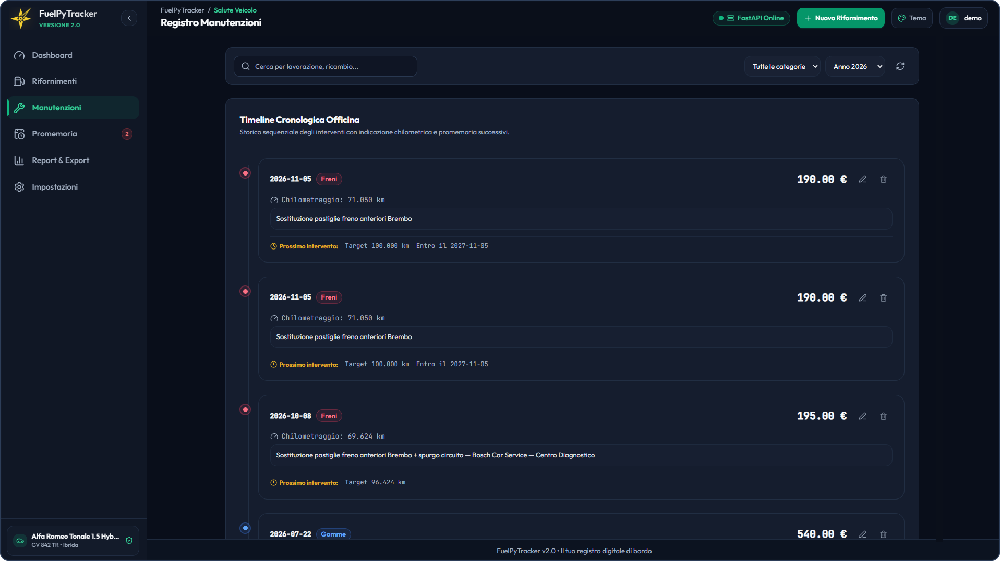
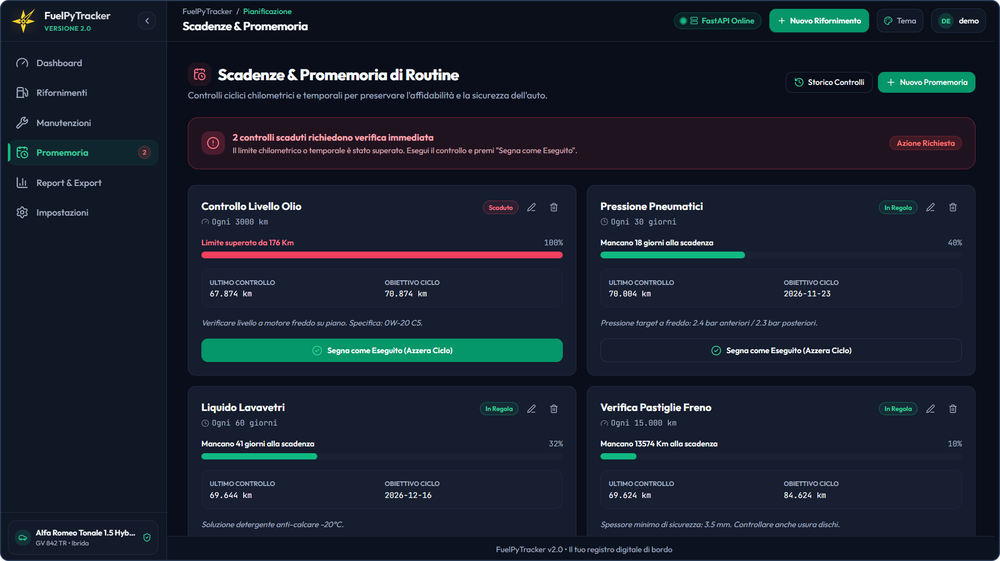
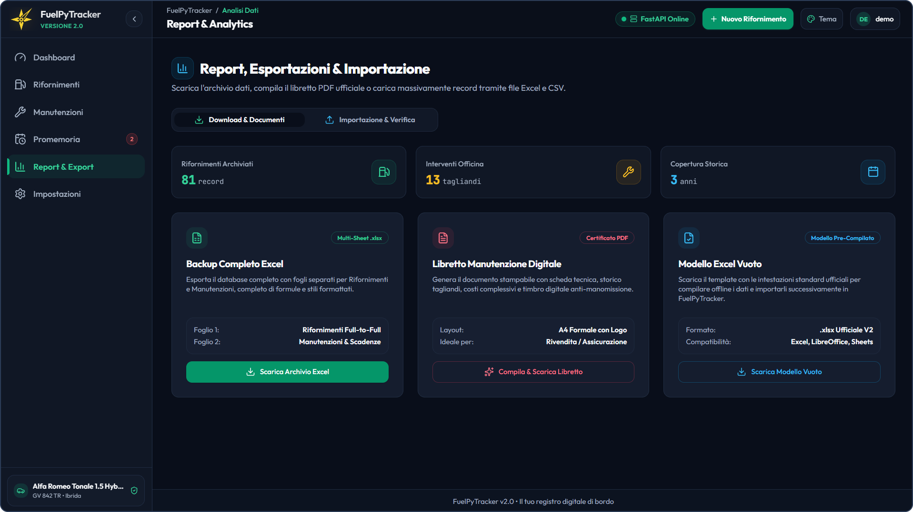

# 📘 Guida Utente — FuelPyTracker V2.0

> **La gestione semplice, chiara e completa del tuo veicolo.**  
> Questa guida spiega come funziona ogni sezione dell'applicazione e come usarla al meglio per tenere sotto controllo costi, consumi, interventi di manutenzione e scadenze della tua auto.

---

## 1. 🔐 Accesso, Privacy e Modalità Demo

FuelPyTracker protegge i dati del tuo veicolo e offre due modalità di utilizzo:

### Account Personale e Riservatezza
- **Accesso Protetto:** L'ingresso avviene tramite email e password personali.
- **Separazione Completa dei Dati:** Ogni informazione inserita (chilometri, spese, annotazioni) è collegata esclusivamente al tuo profilo. Nessun altro utente può vedere o modificare i tuoi dati.
- **Recupero Password:** In caso di dimenticanza, puoi richiedere in autonomia un'email per scegliere una nuova password.

### Modalità Dimostrativa (Sola Lettura)
Se apri l'applicazione in modalità dimostrativa:
- Entri subito con un profilo d'esempio già ricco di rifornimenti e manutenzioni.
- Puoi esplorare liberamente tutte le pagine, provare i filtri, i grafici e il calcolatore di viaggio.
- Le modifiche permanenti e le cancellazioni sono disattivate per mantenere intatti i dati di prova.

---

## 2. 📊 Dashboard: Panoramica su Consumi e Spese

La Dashboard è la schermata principale dell'applicazione. È pensata per rispondere a colpo d'occhio a tre domande pratiche: *quanto consuma davvero la mia auto?*, *quanto sto spendendo?* e *ci sono scadenze o controlli in arrivo?*.

  
   
  <em>Figura 1: Panoramica della Dashboard con i dati di riepilogo e l'andamento nel tempo.</em>

### Riquadri di Riepilogo
- **Consumo Medio (km/L):** Indica quanti chilometri percorri in media con un litro di carburante, aiutandoti a capire quanto è efficiente il tuo stile di guida o se il veicolo consuma più del solito.
- **Costo per Chilometro (€/km):** Mostra quanto ti costa effettivamente ogni chilometro percorso in base alla spesa sostenuta.
- **Spesa Totale e Mensile:** Tiene traccia delle uscite per carburante e manutenzione, facilitando la gestione del budget familiare o lavorativo.
- **Chilometraggio Attuale:** Riporta l'ultima lettura del contachilometri registrata con la relativa data.

### Grafici e Filtri nel Tempo
- **Scelta del Periodo:** Puoi filtrare i grafici su archi temporali diversi (**3 Mesi**, **6 Mesi**, **1 Anno** oppure **Tutto lo Storico**).
- **Andamento dei Consumi e dei Prezzi:** Permette di notare facilmente le variazioni del prezzo al litro e gli eventuali cali di resa dell'auto nel tempo.
- **Confronto delle Spese:** Mette a confronto mese per mese quanto hai speso al distributore rispetto agli interventi in officina.

### Calcolatore di Viaggio Integrato
Uno strumento pratico per stimare in anticipo quanto spenderai per un viaggio (ad esempio una vacanza o una trasferta): ti basta inserire i chilometri da percorrere e l'app calcola subito i litri necessari e il costo stimato, basandosi sul consumo reale della tua auto e sull'ultimo prezzo del carburante registrato.

---

## 3. ⛽ Gestione Rifornimenti e Scansione Scontrini

La sezione Rifornimenti ti permette di registrare ogni sosta al distributore e di calcolare con precisione i consumi nel tempo.

  
   
  <em>Figura 2: Storico dei rifornimenti con calcolo dei consumi e filtri di ricerca.</em>

### Inserimento di un Rifornimento
- **Data e Chilometraggio Totale:** Mentre digiti i chilometri segnati sul cruscotto, l'applicazione controlla subito che il valore sia coerente con i rifornimenti precedenti, segnalandoti eventuali errori di battitura.
- **Prezzo al Litro e Importo Speso:** Il calcolo è automatico in entrambe le direzioni: se inserisci la spesa totale e il prezzo al litro, i litri erogati vengono calcolati da soli (e viceversa).
- **Pieno Completo o Rifornimento Parziale:** 
  - Se fai il **pieno completo**, l'applicazione calcola con precisione il consumo effettivo (km/L) rispetto al pieno precedente.
  - Se fai un **rifornimento parziale** (ad esempio 20 € senza riempire il serbatoio), la spesa e i litri vengono messi da parte e sommati automaticamente quando farai il prossimo pieno completo, così da non falsare mai le medie di consumo.

### 🤖 Scansione Intelligente dello Scontrino (OCR)
Per velocizzare la registrazione quando sei al distributore con lo smartphone:
1. Premi su **Scansiona Scontrino** nella finestra di nuovo rifornimento.
2. Scatta una foto alla ricevuta del distributore oppure scegli un'immagine dalla galleria.
3. Il sistema di lettura automatica analizza la foto e ricava:
   - Data del rifornimento
   - Importo totale pagato (€)
   - Prezzo al litro (€/L)
   - Litri erogati
   - Nome della stazione di servizio (aggiunto nelle note)
4. I dati letti dallo scontrino vengono inseriti automaticamente nel modulo: **dovrai solo digitare i chilometri attuali del veicolo** al momento del rifornimento (un'informazione presente sul cruscotto dell'auto ma non sullo scontrino) e premere conferma.

---

## 4. 🔧 Manutenzioni e Scadenze d'Officina

Tenere un registro ordinato dei lavori effettuati aiuta a prevenire guasti e conserva il valore dell'auto nel tempo.

  
   
  <em>Figura 3: Registro degli interventi in officina con avvisi per le prossime scadenze.</em>

### Tipologie di Intervento
Puoi catalogare ogni spesa di manutenzione scegliendo tra le voci già pronte (oppure creandone di tue nelle impostazioni):
- **Tagliando Completo** (olio, filtri, controlli generali)
- **Freni** (pastiglie, dischi, liquido freni)
- **Pneumatici** (inversione, equilibratura, cambio gomme stagionale)
- **Revisione Ministeriale** e **Bollo**
- **Batteria e Impianto Elettrico**
- **Distribuzione e Cinghie**
- **Altro / Personalizzato** (con descrizione libera dei lavori svolti)

### Avvisi di Scadenza per Data o per Chilometri
Quando registri un intervento, puoi indicare quando dovrà essere ripetuto secondo due criteri (anche contemporaneamente):
1. **Per Data:** utile per scadenze fisse come la revisione o il tagliando annuale.
2. **Per Chilometraggio:** ideale per componenti legati ai chilometri percorsi (come cambio olio, pastiglie freni o cinghia di distribuzione). In base a quanti chilometri percorri in media ogni giorno, l'app stima anche in quale data raggiungerai quella soglia.

---

## 5. ⏰ Promemoria per i Controlli Periodici

Questa sezione è pensata per tutti quei controlli di routine che puoi fare anche in autonomia e che non comportano necessariamente una fattura d'officina:

  
   
  <em>Figura 4: Elenco dei controlli periodici con barra di avanzamento e stato di urgenza.</em>

- Controllo pressione e stato delle gomme
- Rabbocco liquido lavavetri e liquido refrigerante
- Controllo livello olio motore

Ogni promemoria confronta la frequenza che hai scelto (ogni tot chilometri o ogni tot giorni) con l'uso recente dell'auto e ti mostra con colori chiari se il controllo è **In regola**, **In scadenza** o **Scaduto**. Quando effettui il controllo, ti basta premere **Segna come eseguito** per far ripartire il conteggio.

---

## 6. 📑 Report, Importazione Dati e Libretto PDF

La sezione Report riunisce tutti gli strumenti per esportare i tuoi dati o importare uno storico già esistente.

  
   
  <em>Figura 5: Pagina di esportazione dati, creazione del libretto PDF e importazione da file Excel.</em>

### Importazione Guidata da Excel o CSV
Se tenevi già i conti su un foglio Excel o su un'altra applicazione, puoi importarli senza il rischio di rovinare i dati già salvati:
1. **Controllo e Anteprima:** Caricando il file (Excel o CSV), l'applicazione controlla ogni riga e te la mostra in anteprima con un colore diverso:
   - *Nuovo inserimento valido* (verde)
   - *Aggiornamento di un dato già presente* (blu)
   - *Voce identica già salvata* (grigio, ignorata automaticamente per evitare doppioni)
   - *Valore dubbio o errore* (giallo o rosso, con una nota che spiega cosa non torna)
2. **Correzione Diretta:** Se qualche riga presenta una svista (ad esempio un importo o un chilometraggio errato), puoi correggerla direttamente nella schermata di anteprima prima di procedere.
3. **Salvataggio Finale:** Solo quando tutte le righe sono corrette e confermi l'operazione, i dati vengono salvati nel tuo archivio.

### Creazione del Libretto di Manutenzione in PDF
Con un solo clic puoi scaricare un documento PDF ordinato e pronto da stampare che contiene:
- I dati identificativi del veicolo (modello, targa, proprietario)
- L'elenco cronologico di tutti gli interventi di manutenzione eseguiti con i relativi chilometri
- Il riepilogo della spesa complessiva sostenuta per la cura del mezzo
- **Perché è utile:** È un documento prezioso da conservare nel cassetto dell'auto o da mostrare a un eventuale acquirente quando deciderai di vendere il veicolo usato, dimostrando tutte le manutenzioni effettuate.

---

## 7. ⚙️ Impostazioni, Profilo Veicolo e Temi

Dalla pagina Impostazioni puoi personalizzare l'applicazione in base alla tua auto e alle tue preferenze:
- **Dati del Veicolo:** Nome o modello dell'auto, targa e tipo di carburante utilizzato (Benzina, Diesel, GPL, Metano, Ibrida o Elettrica).
- **Soglie di Avviso e Categorie:** Personalizzazione dei limiti di spesa per gli avvisi e aggiunta o rimozione delle categorie di manutenzione e promemoria.
- **Gestione Account:** Controllo del profilo attivo, modifica delle credenziali e disconnessione.
- **Scelta del Tema Grafico:** Passaggio immediato tra i 3 temi disponibili (*Dark Slate*, *OLED Pure Black* e *Clean Light*).

